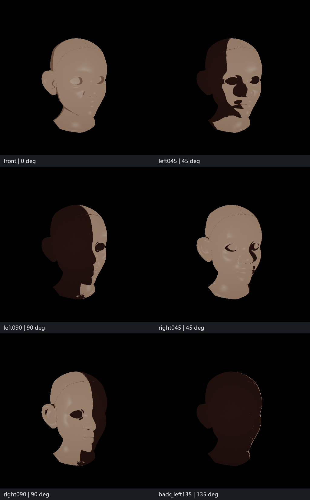
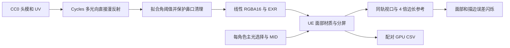

# 个人面部 SDF 光照与角色时域稳定

从一个 CC0 静态头模烘焙逐像素的面部光照角阈值，在 Unreal Engine 中用主光方向驱动阴影线，再用同轨视口和超采样参考量化面部与轮廓的时域误差。



## 管线



| 目录 | 内容 |
|---|---|
| [tools/face_sdf](tools/face_sdf/) | Cycles 烘焙、BVH 对照、鼻口保护、颈根清理、PNG16 回读 |
| [tools](tools/) / [tests](tests/) | 闪烁计算、GPU CSV 汇总、光照矩阵拼图和 Python 回归测试 |
| [ue/shaders](ue/shaders/) / [ue/python](ue/python/) | FaceProject、AnalyticStep、SplitWipe 和验证工程准备与截图 |
| [ue/plugins](ue/plugins/) | 主光选择与 MID 写入 FaceKeyLight，擦除控件 FaceWipeUI |
| [ue/experiments/character_temporal](ue/experiments/character_temporal/) | 同轨采集、描边变体、指标与对照视频生成 |
| [ue/host](ue/host/) / [ue/source](ue/source/) / [examples](examples/) | 验证工程描述、CC0 小样导入文件、既有实测图 |

## 运行

离线工具使用系统 **Python 3.13**、NumPy 和 Pillow，本次测试使用 3.13.15。烘焙使用 **Blender 5.2 LTS**，既有实测为 5.2.4。UE 脚本在 **Unreal Engine 5.8.3** 的编辑器 Python 中运行，既有实测使用 Windows Win64、DX12 / SM6。编译插件需要该引擎版本配套的 C++ 工具链。

从仓库根目录执行。`captures` 和 CSV 为调用者采集的数据。

```powershell
python -B -m unittest discover -s tests
python -B tools/contact_sheet.py captures/matrix --out matrix.png
python -B tools/flicker_metric.py --test captures/test --ref captures/reference --out outputs/flicker
python -B tools/gpu_csv_report.py baseline.csv --compare candidate.csv --json gpu.json
```

若系统 Python 缺少依赖，可用 uv 临时提供。

```powershell
uv run --no-project --with numpy --with pillow -- python -B -m unittest discover -s tests
```

### Blender 烘焙

`head_geometry.npz` 含 CC0 `GEO-head_stylized` 的网格、UV 和角法线。重新烘焙需要先生成本地 `PublicHead.blend`。从 Blender 官方镜像下载 v1.4.1，将 `human_base_meshes_bundle.blend` 解出至 `tools/face_sdf/inputs/`，然后在独立工作副本提取头模。完整源包哈希可核对来源记录。 [下载 CC0 资产包](https://mirror.blender.org/demo/asset-bundles/human-base-meshes/human-base-meshes-bundle-v1.4.1.zip) · [来源记录](tools/face_sdf/inputs/source_provenance.json)

```powershell
blender -b --factory-startup --disable-autoexec --python-exit-code 7 --python tools/face_sdf/extract_head.py
```

将 Blender 加到 `PATH`，或给管线设置 `BLENDER_EXE`。提取成功后运行八阶段烘焙入口，生成日志和回执并覆盖工作副本对应的预览图与纹理。UE 示例使用仓库随附的 FBX 和 EXR，可独立重建。

```powershell
python -B tools/face_sdf/run_pipeline.py
python -B tools/face_sdf/neck_review_v001/build_neck.py tools/face_sdf/PublicHead outputs/neck
```

RGBA16 的 **G** 保存从头部正前方 −Y 向 +X 侧扫至背面的角阈值除以 180°。**R** 是 G 的 U 镜像，**B** 为 UV 覆盖，**A** 为 1。材质按灯向侧轴符号取 G 或 R，阈值大于归一化水平角时为亮。用 Non-Color 读取纹理。UE 样本用线性 EXR、关闭 sRGB、TC_HDR、无 mip、NeverStream、Clamp。 [烘焙细节](tools/face_sdf/README.md)

### UE 材质与截图

在短、纯 ASCII、无空格的工作副本执行。将 `UE_DIR` 设为 UE 5.8.3 安装根目录。下列命令构建 FaceKeyLight 的 Win64 编辑器插件并复制到验证宿主。准备脚本会在该宿主的 `/Game/FaceProject/L_PublicFace` 重建头模、材质和关卡。

```powershell
$repo = (Get-Location).Path
$uat = Join-Path $env:UE_DIR 'Engine/Build/BatchFiles/RunUAT.bat'
$editor = Join-Path $env:UE_DIR 'Engine/Binaries/Win64/UnrealEditor.exe'
$env:UE_EDITOR_CMD = Join-Path $env:UE_DIR 'Engine/Binaries/Win64/UnrealEditor-Cmd.exe'
$plugin = Join-Path $repo 'ue/plugins/FaceKeyLight/FaceKeyLight.uplugin'
$package = Join-Path $repo 'outputs/FaceKeyLight'
$hostPlugins = Join-Path $repo 'ue/host/Plugins'
$project = Join-Path $repo 'ue/host/FaceProject.uproject'
$prepare = Join-Path $repo 'ue/python/prepare_face_project.py'
$capture = Join-Path $repo 'ue/python/capture_face_project.py'

& $uat BuildPlugin "-Plugin=$plugin" "-Package=$package" -NoTargetPlatforms
if ($LASTEXITCODE -ne 0) { throw 'BuildPlugin failed' }
New-Item -ItemType Directory -Force -Path $hostPlugins | Out-Null
Copy-Item -LiteralPath $package -Destination $hostPlugins -Recurse
& $editor $project -Unattended -NoP4 -NoSplash -dx12 -sm6 "-ExecutePythonScript=$prepare"
```

确认 `ue/evidence/prepare.json` 状态为 `SAVED` 后，运行视口与 SceneCapture 采集，等待 `ue/evidence/run.json` 状态为 `COMPLETE`。

```powershell
& $env:UE_EDITOR_CMD $project /Game/FaceProject/L_PublicFace -game -Unattended -NoP4 -NoSplash -nosound -dx12 -sm6 -ResX=768 -ResY=768 -windowed "-ExecCmds=py $capture"
```

光照矩阵可单独运行。给方向光加 `LM_Sun` 标签，在编辑器 Output Log 的 Cmd 模式执行 `py "<仓库路径>/ue/python/light_matrix_capture.py"`，等截图保存于 `Saved/Screenshots` 且灯光恢复。按场景曝光调节灯强。FaceWipeUI 依赖 FaceKeyLight，在目标 C++ 工程的 Plugins 目录放入两份插件源码并编译。 [控件接入](ue/plugins/FaceWipeUI/接入说明.md) · [同轨时域与描边命令](ue/experiments/character_temporal/README.md)

## 已实测

以下记录使用 UE 5.8.3。默认 3° 的 TSR 加宽实验重新采集了基线、原算法、参考和三个候选；其余各项沿用原实验。

| 检查 | 结果及适用条件 |
|---|---|
| CC0 小样与 Cycles | 4,118 顶点、8,232 三角，1024²、35 光向。Cycles 与 BVH 的前脸亮暗一致率 99.184%。单阈值相对 Cycles 的前脸平均差 0.390%，全头 9.853%。三档清理的 97,116 个鼻口保护纹素均保持原值。既有八阶段重跑的四张 Cycles RGBA16 图 SHA-256 一致。 [光向图](tools/face_sdf/PublicHead/renders_cycles_ContactSheet.png) |
| UE 纹理与主光 | 六光向及 20% / 50% / 80% 三档擦除，九组主光向与 MID 回读一致。八个阈值或覆盖样点的 GPU 回读，RGB 最大归一化误差 0.0000073911。 [六光向截图](examples/six_directions.png) |
| 固定曝光矩阵与移动硬边 | 矩阵 12/12 独立截图并恢复灯光。关闭引擎 AA 的受控移动硬边夹具，误差闪烁从 0.01974965 降至 0.006695285（下降 66.10%） |
| 三条描边路径 | 开启 TSR 后，反面壳从 0.029826 降至 0.016664（下降 44.13%），TSR 前模板轮廓从 0.033400 降至 0.027763（下降 16.88%），TSR 后模板轮廓从 0.044998 升至 0.058679（上升 30.40%）。各路径使用自己的参考，线条覆盖不同。 [实帧对照](examples/outline_comparison.jpg) |
| 配对整帧 GPUTime | RTX 5080 Laptop，1024² 固定近景、45° 主光、TSR、0° 软边。AB / BA / AB 三对，每段 60 秒。各段 P50 的中位数为 0.8568 / 0.8558 ms（关 / 开，−0.117%）。三对变化方向不一致，差异均低于 2% 判定线。两档共用同一 shader，测量覆盖 EnableAA 动态切换的整帧耗时。 [配对图](examples/paired_gpu.png) |

面部指标在眼鼻嘴区域取参考的边缘并集，计算相邻帧亮度残差变化的绝对值均值。头模保持中性，相机每 tick 平移 0.055 cm，采 32 帧。384² 视口与 1536² 无引擎 AA 参考做同帧比较，参考经 4×4 均值下采样。 [测量区域](examples/face_roi.png)

| 材质内核与软边 | 引擎 AA | 解析关 → 解析开 | 误差闪烁变化 |
|---|---|---:|---:|
| 现有材质 0° | 关 | 0.011844 → 0.008333 | 下降 29.65% |
| 现有材质 0° | TSR | 0.007264 → 0.007849 | 上升 8.05% |
| 现有材质默认 3° | 关 | 0.008106 → 0.007253 | 下降 10.53% |
| 现有材质默认 3° | TSR | 0.006497 → 0.006864 | **上升 5.64%** |
| 独立试样 0° | 关 | 0.011911 → 0.008324 | 下降 30.12% |
| 独立试样 0° | TSR | 0.007267 → 0.008180 | 上升 12.56% |
| 独立试样 3° | 关 | 0.008106 → 0.007917 | 下降 2.33% |
| 独立试样 3° | TSR | 0.006497 → 0.007533 | 上升 15.95% |

暂定门槛为误差闪烁下降 30%。八组中仅独立试样的 0°、关闭引擎 AA 组合达标。试样在硬边用线性覆盖，在软边对 smoothstep 做像素区间积分。

### 默认 3° 的 TSR 加宽权重

同一 CC0 头模、+90° 主光、100% 屏幕比例。相对 TSR 下无额外加宽的基线，只有权重 0 达到本轮「闪烁不升高」的要求。该档保留原有 3° 软边，32/32 张 PNG 与基线逐张同哈希。两档非零权重都未取得下降。 [同帧实图](examples/tsr_width.png) · [复验命令与掩码定义](ue/experiments/character_temporal/README.md#tsr-加宽权重)

| 额外加宽权重 | 眼鼻嘴误差闪烁 | 相对基线 | 头部外轮廓误差闪烁 | 相对基线 |
|---|---:|---:|---:|---:|
| 基线 0 | 0.006497226 | — | 0.004987150 | — |
| 原算法 1 | 0.006863604 | +5.6390% | 0.005051017 | +1.2806% |
| 1/4 | 0.006559249 | +0.9546% | 0.005000933 | +0.2764% |
| 1/16 | 0.006518942 | +0.3342% | 0.004987296 | +0.0029% |
| TSR 回退 0 | 0.006497226 | 0.0000% | 0.004987150 | 0.0000% |

同张头模 1024² 固定近景、3°、+90°、TSR 历史比例 200%，RTX 5080 Laptop。仅本任务 UE 进程运行时采集 18 段，各候选三对 AB / BA / AB。整帧 GPUTime 按各段 P50 再取三轮中位数，1/4 为 1.0308 → 1.0296 ms（−0.116%），1/16 为 1.0308 → 1.0312 ms（+0.039%），回退为 1.0296 → 1.0311 ms（+0.146%）。三个候选的配对差值方向均不一致，均低于 2% 分辨门槛。 [采集与统计脚本](ue/experiments/character_temporal/TsrWidthPerf/)

## 已知限制

- 单角阈值只保存一次亮到暗的转换，耳内、背面与极端光向需逐镜头审阅。R/G 镜像依赖几何及 UV 的左右对应，非对称头模需要双侧编码。
- 材质为 Unlit 验证版。表情、骨骼动作、头发、皮肤 PBR 混合、多灯竞争、遮挡采样和移动端需各自验证。
- GPU 配对结果限于该镜头、设备和设置。静态移除导数计算的成本仍待单独测量。

## English summary

Face SDF Lab bakes angular shadow thresholds from a CC0 stylized head in Blender Cycles and consumes them in UE 5.8.3 with per-actor key light selection and a screen-space wipe. At the default 3° transition, full analytic widening reduced face-region flicker by 10.53% with engine AA disabled and increased it by 5.64% with TSR. The opt-in TSR preset disables the extra width and exactly matches the no-widening baseline in all 32 frames. Both tested nonzero caps still increased face-region flicker.

## 致谢

`GEO-head_stylized` 来自 Blender Studio 和 Blender 社区的 Human Base Meshes v1.4.1，资产以 CC0 提供。仓库内几何数组与 UE 导入网格由该对象提取。 [Blender 官方资产页](https://www.blender.org/download/demo-files/) · [随包 CC0 说明](tools/face_sdf/inputs/bundle_README.txt)

许可：代码与文档以 [MIT](LICENSE) 发布；`GEO-head_stylized` 及由其提取的几何仍按原始 CC0 条款。
